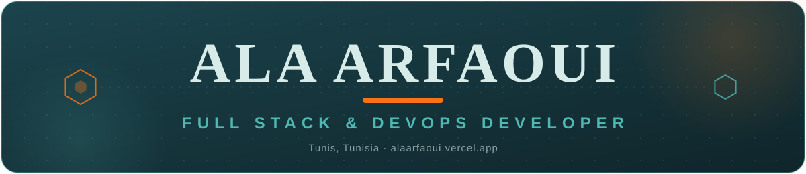

<div align="center">



<a href="https://alaarfaoui.vercel.app"></a>
<a href="https://linkedin.com/in/elarfaoui-ala"></a>
<a href="mailto:elarfaouiala@gmail.com"></a>
<a href="tel:+21620773759"></a>
<a href="https://www.google.com/maps/place/Tunis,+Tunisia"></a>


</div>

---

## 🚀 Featured Projects

### 🔩 [Microservices Platform](https://github.com/elarfaoui-ala/services)

Production-grade monorepo with four modules — **auth · notifications · dashboard · AI** — each pairing a **NestJS** backend with a **Next.js 14** frontend behind an **nginx API gateway**, on PostgreSQL &amp; Redis. Ships a full **Prometheus / Grafana / Alertmanager** observability stack, and a CI/CD pipeline that builds all **9 Docker images**.


### 🎁 [Loyalty Widget](https://github.com/elarfaoui-ala/loyalty-app)

Open-source, drop-in **punch-card loyalty system** for restaurants and small food businesses — a single `<script>` embeddable widget (**Lit** web component) backed by a **multi-tenant NestJS API** with Prisma on PostgreSQL. Passwordless OTP sign-in, HMAC-signed webhooks with retries and dead-letter queues, Swagger docs, and 48 passing tests.


### 📦 [DrivEx Delivery](https://github.com/elarfaoui-ala/drivex-backend)

**Spring Boot** backend powering a cross-platform **React Native** delivery app — real-time order tracking, driver status flows, and role-based access.
📖 Case study: [portfolio page](https://alaarfaoui.vercel.app/projects/delivery-app)


---

## 👨‍💻 About Me

```ts
const ala = {
  role: "Freelance DevOps & Full Stack Developer",
  base: "Tunis, Tunisia",
  education: "BSc Computer Science — Faculty of Sciences, Sfax (2024)",
  languages: ["Arabic (native)", "French (fluent)", "English (professional)"],
  focus: ["microservices", "CI/CD", "observability", "clean architecture"],
} satisfies Developer
```

---

## 📈 What I'm Doing Now

- 🔨 Building microservices platforms and containerized CI/CD pipelines
- 📚 Deepening expertise in DevOps, observability, and cloud infrastructure
- ✍️ Writing about what I build on [my blog](https://alaarfaoui.vercel.app/blog)

---

## 🧰 Tech Stack

| Domain | Tools |
|--------|-------|
| **Frontend** | React · Next.js · React Native · Electron · TypeScript · Tailwind CSS |
| **Backend** | Node.js · Express · NestJS · PHP · REST APIs · JWT / OAuth2 |
| **Database** | PostgreSQL · MySQL · MongoDB · Prisma |
| **DevOps &amp; Cloud** | Docker · GitHub Actions · CI/CD · Nginx · Prometheus · Linux · Vercel |

---

## 📊 GitHub Activity

<div align="center">

<a href="https://github.com/elarfaoui-ala">
  
</a>
<a href="https://github.com/elarfaoui-ala">
  
</a>

<a href="https://github.com/elarfaoui-ala">
  
</a>


</div>

---

## ✍️ Latest Writing

Fresh posts from [my portfolio blog](https://alaarfaoui.vercel.app/blog), pulled in automatically:

<!-- BLOG_POSTS_START -->
- [10 Next.js App Router Mistakes (And Fixes)](https://alaarfaoui.vercel.app/blog/10-nextjs-app-router-mistakes-and-fixes)
- [Containers First: Building a Repeatable CI/CD Pipeline](https://alaarfaoui.vercel.app/blog/containers-first-cicd-pipeline)
- [How I Built a SEO-Ready Portfolio with TanStack Start](https://alaarfaoui.vercel.app/blog/building-a-seo-ready-portfolio)
<!-- BLOG_POSTS_END -->

---

## 💬 Let's Connect

Open to **full stack &amp; DevOps freelance work**, open-source collaborations, and interesting problems.

<div align="center">

[](mailto:elarfaouiala@gmail.com)
[](https://linkedin.com/in/elarfaoui-ala)
[](https://alaarfaoui.vercel.app)
[](tel:+21620773759)

</div>
